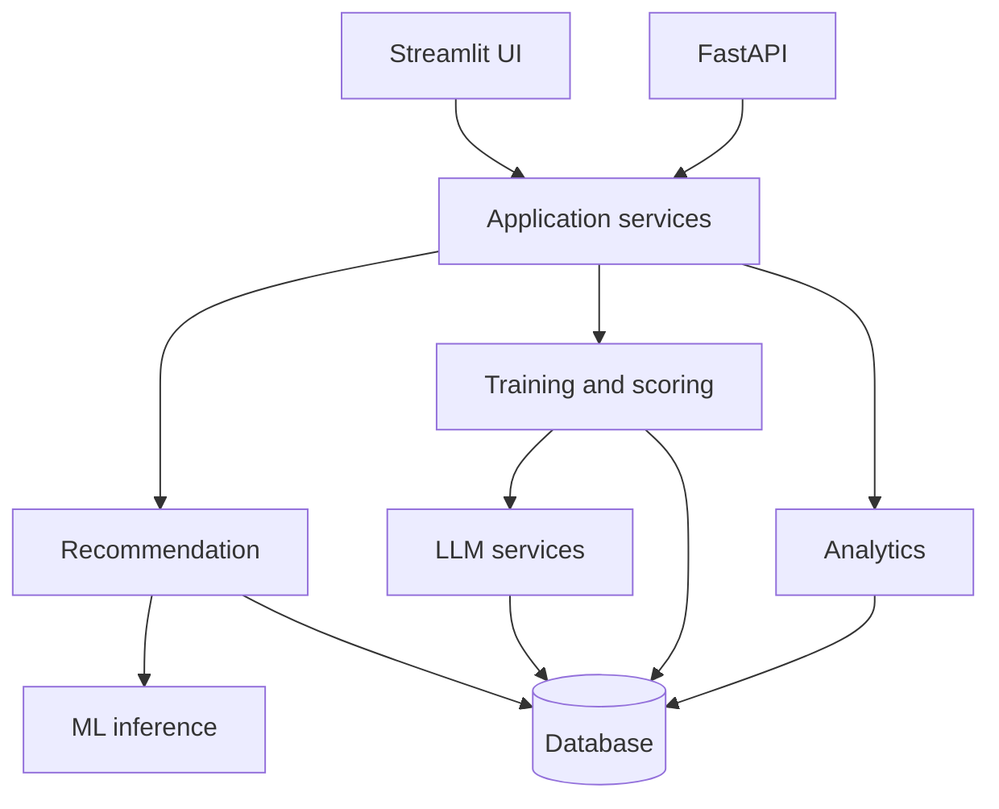

# Architecture

## Interfaces and shared services

The Streamlit product and FastAPI service are two interfaces over the same Python modules. Streamlit handles interactive presentation. FastAPI handles HTTP validation, status codes, and response serialization. Neither contains recommendation, scoring, ML, or analytics implementations.

## Recommendation pipeline

The engine creates one candidate for each cognitive category. For each candidate it:

1. calculates weakness, recency, preference, energy, and exploration features;
2. applies rolling-window difficulty adjustment;
3. predicts session-completion probability using the saved pipeline or bounded rule fallback;
4. combines `0.75 × learning priority + 0.25 × completion probability`;
5. chooses the highest final score and produces a factual explanation.

The larger priority weight prevents predicted convenience from overriding learning need. Persisted recommendations include both component scores, the final score, and model source.

## AI generation and evaluation

`LLMClient` minimizes profile fields before constructing a versioned prompt. API output is parsed and validated as `ExerciseSchema`. Any network, JSON, envelope, schema, or safety failure returns a category-specific deterministic exercise. Telemetry records source, prompt version, schema validity, fallback use, error class, latency, and tokens when reported.

Open-ended evaluation returns `EvaluationSchema`: overall score, relevance, coherence, task completion, feedback, and tags. With no API key—or after API failure—a versioned deterministic lexical rubric is used and labeled as such. Attempt records retain the method and evaluator version.

## Persistence

SQLAlchemy models use portable types and query expressions. SQLite foreign-key enforcement is enabled only for SQLite connections. Other configuration is dialect-neutral, allowing a PostgreSQL `DATABASE_URL` in deployment.

Core records:

- users and non-medical preferences
- daily check-ins
- sessions and completion status
- exercise attempts and evaluator provenance
- recommendations and ranking components
- AI-generation telemetry
- performance metrics and feedback events

The current prototype initializes tables directly. A production deployment should use schema migrations.

## Analytics

Pandas transformations calculate category rolling averages, difficulty histories, engagement metrics, streaks, and directional changes. Both Streamlit and the insights API use the same functions.

## Failure behavior

- Missing/corrupt ML artifact: bounded completion-rule fallback
- Missing API key: deterministic exercise generator and deterministic evaluation rubric
- LLM timeout/invalid output: retry within the configured budget, then fallback
- Unknown API entity: structured 404 response
- Invalid API payload: FastAPI/Pydantic 422 response
- Empty product history: cold-start priors and explicit empty dashboard states

## Deployment boundary

The Docker image runs Streamlit as an unprivileged user and excludes secrets, local databases, and generated model artifacts. FastAPI can run as a second process or separate container. Authentication, authorization, rate limiting, encryption, managed PostgreSQL, and migrations remain deployment responsibilities rather than simulated features in this portfolio project.

