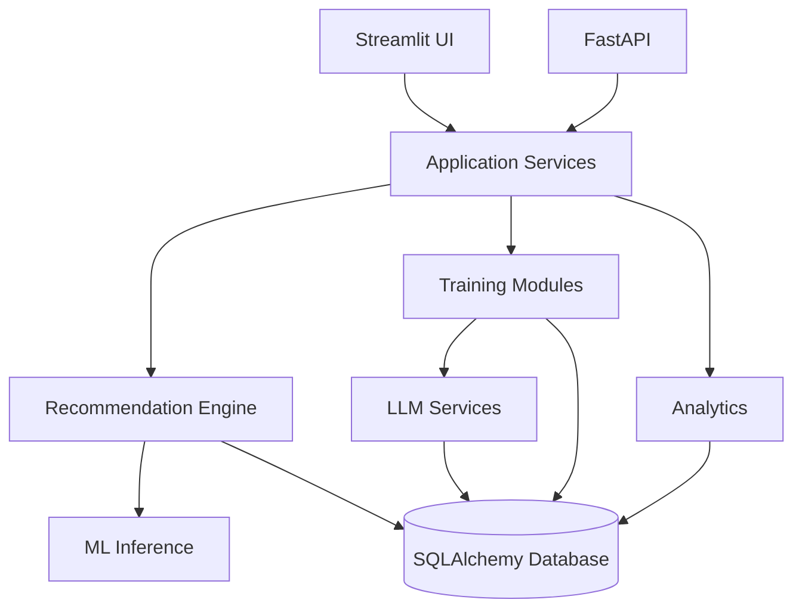

# Healthy Aging AI Platform

A Python application for adaptive cognitive training, explainable recommendations, and lightweight machine-learning personalization.

The project demonstrates:

- Python application architecture
- FastAPI REST APIs and a Streamlit frontend
- SQLAlchemy persistence and recommendation systems
- Machine-learning inference
- Structured LLM generation and evaluation
- Automated testing, Docker, and CI

**Tech stack:** Python · FastAPI · Streamlit · SQLAlchemy · SQLite/PostgreSQL · scikit-learn · Pydantic · Pandas · Plotly · pytest · Docker · GitHub Actions

## Screenshots

<!-- Add portfolio screenshots to docs/images/ -->

Recommended filenames: `home.png`, `training.png`, `dashboard.png`, and `insights.png` in `docs/images/`.

## Overview

Healthy Aging AI combines cognitive activities, daily readiness inputs, adaptive difficulty, explainable recommendations, ML-assisted completion prediction, and progress analytics. Exercises can be generated through an OpenAI-compatible API or through deterministic local generators when no API key is available.

This is a portfolio and research prototype, not a clinical product.

## Key Features

- User profiles and daily check-ins
- Memory, attention, reasoning, language, and optional light-movement activities
- Adaptive difficulty based on a recent-performance window
- Weighted recommendation ranking with stored score components
- ML-assisted session-completion probability
- Plain-language recommendation explanations
- Longitudinal performance, difficulty, and engagement analytics
- FastAPI endpoints shared with the Streamlit application services
- Pydantic-validated LLM exercise generation
- Structured open-ended response evaluation
- Deterministic offline generation, evaluation, and ML fallbacks
- Docker support, GitHub Actions CI, and an automated pytest suite

## System Architecture



Streamlit and FastAPI reuse the same repositories, scoring, recommendation, and analytics modules.

## Recommendation Logic

The engine creates a candidate plan for each cognitive category. Learning priority combines weakness, recency, stated preference, current energy, and exploration value.

```text
final score =
0.75 × learning priority
+ 0.25 × estimated completion probability
```

Learning priority retains the larger weight so estimated convenience does not replace training need. Each saved recommendation includes both component scores, the final score, the inference source, and a user-facing explanation.

## Machine Learning

The model predicts the probability that a proposed session will be completed. Features include recent scores, rolling-average score, energy, sleep quality, category, difficulty, completion history, session length, and time since practice.

`src/ml/train.py` compares Logistic Regression, Random Forest, and Gradient Boosting using accuracy, precision, recall, F1, and ROC-AUC. Training uses seeded synthetic data. If the selected artifact is unavailable, inference uses a bounded deterministic rule.

## LLM Pipeline

The generation pipeline sends a versioned prompt to an OpenAI-compatible endpoint, parses JSON, and validates it with Pydantic before display. Timeouts, invalid JSON, schema failures, or missing credentials route to category-specific local generators.

Open-ended evaluation returns score, relevance, coherence, task completion, feedback, and tags. Without API access, the application uses a versioned lexical rubric and identifies it as deterministic evaluation.

Run the offline quality check with:

```bash
python scripts/evaluate_ai_pipeline.py
```

## API

| Method | Endpoint | Purpose |
|---|---|---|
| `GET` | `/health` | Service health |
| `GET` | `/users/{user_id}` | Retrieve a profile |
| `POST` | `/checkins` | Save a daily check-in |
| `POST` | `/recommendations` | Generate and persist a recommendation |
| `POST` | `/sessions` | Start a training session |
| `POST` | `/score` | Score and optionally persist an attempt |
| `GET` | `/users/{user_id}/insights` | Return derived progress insights |

Interactive API documentation is available at `http://localhost:8000/docs` while FastAPI is running.

## Data Model

SQLAlchemy models store users, daily check-ins, sessions, exercise attempts, recommendations, AI-generation telemetry, performance metrics, and feedback events. SQLite is the local default. A deployment can supply a PostgreSQL URL through `DATABASE_URL`.

Generated databases and trained model artifacts are excluded from Git.

## Project Structure

```text
app.py                  Streamlit entry point
api/                    FastAPI application, schemas, and routes
pages/                  Streamlit product pages
src/ai/                 Generation, validation, and evaluation
src/database/           SQLAlchemy models and repository
src/training/           Exercise generators
src/recommendation/     Ranking, difficulty, and explanations
src/analytics/          Metrics, trends, and insights
src/ml/                 Features, training, and inference
scripts/                Demo-data and AI-evaluation scripts
tests/                  Automated tests
notebooks/              ML exploration notebook
docs/images/            Portfolio screenshot destination
```

## Running Locally

```bash
python3.11 -m venv .venv
source .venv/bin/activate
pip install -r requirements.txt
python scripts/generate_demo_data.py
python -m src.ml.train
streamlit run app.py
```

Start the API in a second terminal:

```bash
source .venv/bin/activate
uvicorn api.main:app --reload
```

The application works without an API key. Copy `.env.example` to `.env` only when local overrides are needed.

## API Usage

Health check:

```bash
curl http://localhost:8000/health
```

Generate a recommendation for the demo user:

```bash
curl -X POST http://localhost:8000/recommendations \
  -H "Content-Type: application/json" \
  -d '{"user_id": 1}'
```

## Docker

```bash
docker build -t healthy-aging-ai .
docker run --rm -p 8501:8501 healthy-aging-ai
```

Pass configuration explicitly when required:

```bash
docker run --rm -p 8501:8501 \
  -e DATABASE_URL=sqlite:////app/data/healthy_aging.db \
  healthy-aging-ai
```

The image excludes `.env`, local databases, trained artifacts, and temporary files.

## Testing

```bash
pytest -q
python -m compileall -q app.py api src scripts tests
```

The suite covers persistence, scoring, difficulty adaptation, recommendation ranking, ML fallback, structured AI validation, evaluation fallback, database configuration, and API endpoints.

## CI

`.github/workflows/tests.yml` runs on pushes and pull requests. It installs Python 3.11 dependencies, performs compilation and import checks, and runs pytest.

## Limitations

- ML training uses synthetic demonstration data.
- Completion probabilities are not calibrated on real user behavior.
- The local evaluator measures lexical signals rather than semantic meaning.
- External LLM quality has not been benchmarked in this repository.
- Authentication, migrations, encryption controls, and rate limiting are required before multi-user deployment.
- Real-world effectiveness has not been validated.

## Responsible Use

- General wellness scope only; no diagnosis or treatment output
- No collection of medical history
- Optional, conservative movement instructions
- Explainable recommendation components
- Structured validation before generated content reaches the UI
- Deterministic operation when external AI services are unavailable

## Future Improvements

- Evaluate completion predictions on consented, representative usage data
- Add probability calibration and model-drift monitoring
- Add database migrations and deployment authentication
- Conduct accessibility and localization reviews with target users
- Build a versioned benchmark set for generated exercises and evaluators

## Author

Yi Xin Ding
